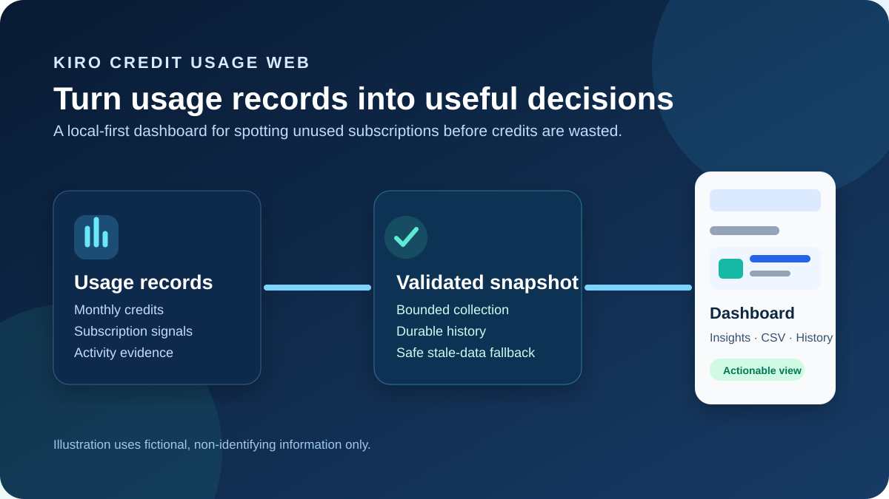
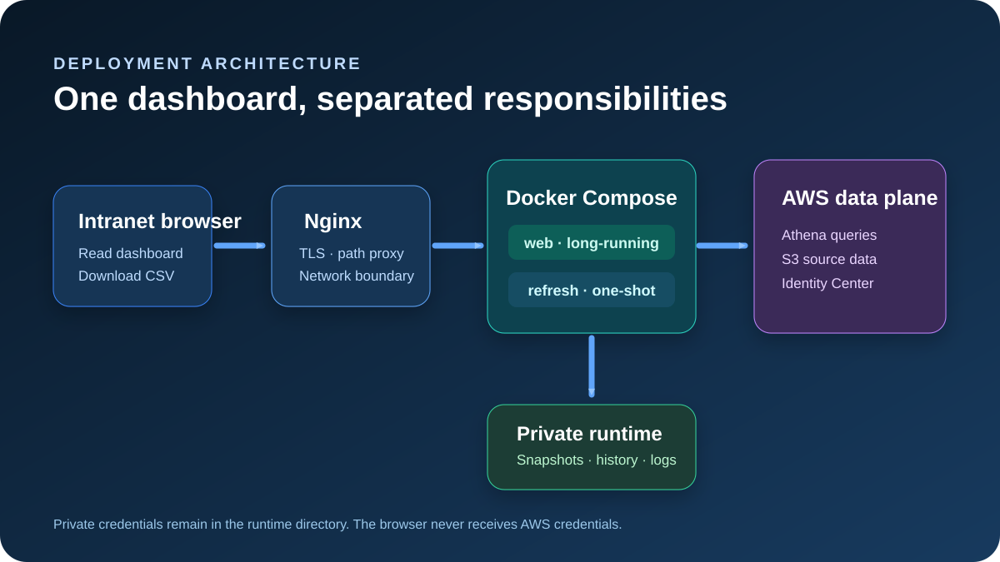
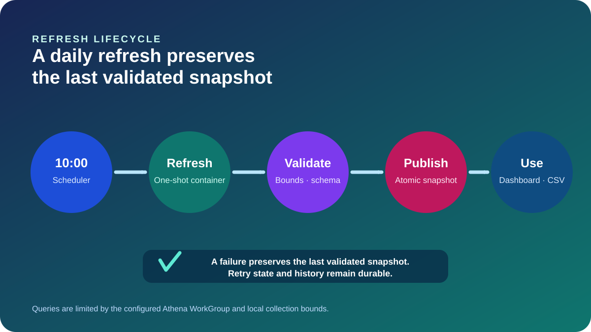
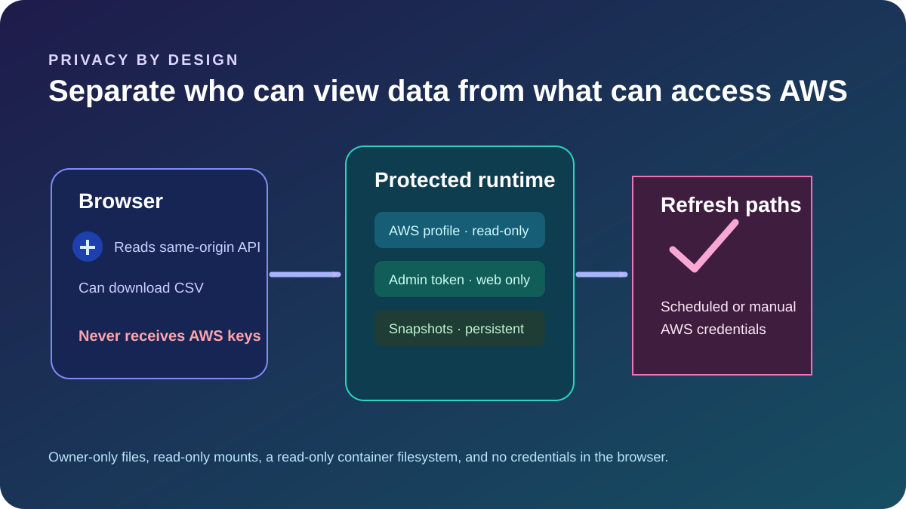

# Kiro Credit Usage Web

A local-first, privacy-aware dashboard for reviewing current-month Kiro Credits usage across subscribed accounts. It uses AWS CLI and Athena for bounded collection, stores validated snapshots locally, and preserves the last good snapshot when a refresh fails.

## Deployment architecture

Published images support `linux/amd64` and `linux/arm64`.

- `chowrex/kiro-credit-usage-web:0.2.0` is the current versioned release.
- `chowrex/kiro-credit-usage-web:latest` is the latest published stable release.

For repeatable deployments, pin a versioned tag rather than using `latest`.

## Data refresh lifecycle

The long-running `web` service serves the dashboard. The one-shot `refresh` service runs manually or from host cron. A failed refresh retains the latest validated snapshot rather than replacing it with partial or blank data.

## Privacy boundary

The browser never receives AWS credentials. Runtime configuration, AWS credentials, administrator token, snapshots, and logs belong in a protected host directory and must not be committed to source control.

Use the repository Docker Compose configuration and complete bilingual deployment instructions:

- Source repository: https://github.com/ChowRex/kiro-credit-usage-web
- Docker assets: [`docker/`](https://github.com/ChowRex/kiro-credit-usage-web/tree/main/docker)
- English and Chinese illustrations: [`assets/illustrations/`](https://github.com/ChowRex/kiro-credit-usage-web/tree/main/assets/illustrations)

> This project is intended for controlled company networks. The dashboard may expose names, email addresses, and usage information, so do not publish it directly to the public internet without TLS, network controls, and individual authentication.

## 简体中文图片

- [项目用途图](https://github.com/ChowRex/kiro-credit-usage-web/blob/main/assets/illustrations/purpose-zh.svg)
- [部署架构图](https://github.com/ChowRex/kiro-credit-usage-web/blob/main/assets/illustrations/architecture-zh.svg)
- [刷新流程图](https://github.com/ChowRex/kiro-credit-usage-web/blob/main/assets/illustrations/refresh-flow-zh.svg)
- [隐私边界图](https://github.com/ChowRex/kiro-credit-usage-web/blob/main/assets/illustrations/security-zh.svg)
