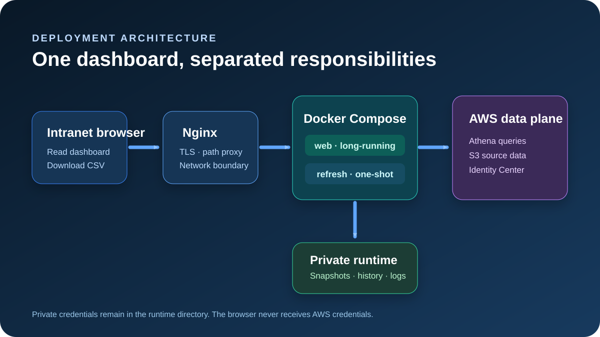

# Docker deployment assets

This directory keeps the container deployment assets together:

- `Dockerfile` builds the dashboard image from the repository-root build context.
- `compose.yaml` runs the long-lived `web` service and the one-shot `refresh` service.
- `container.env.example` documents the required private host paths and image tag.
- `kiro-credit-usage.crontab.template` starts the one-shot refresh container at Beijing 10:00.
- `DOCKERHUB_OVERVIEW.md` is the ready-to-paste Docker Hub repository overview.

Keep `.dockerignore` at the repository root because the Docker build context is the repository root. It prevents private runtime configuration, AWS credentials, tokens, snapshots, and development-only files from entering the image build context.

## Documentation illustrations

The diagrams are original project assets. They use fictional, non-identifying examples only and do not contain production users, email addresses, account identifiers, host addresses, credentials, tokens, snapshots, or AWS resource identifiers.

- English diagrams: [`../assets/illustrations/`](../assets/illustrations/)
- Chinese diagrams: [`../assets/illustrations/`](../assets/illustrations/)
- Docker Hub overview: [`DOCKERHUB_OVERVIEW.md`](DOCKERHUB_OVERVIEW.md)

For complete English and Chinese setup instructions, including local builds, Docker Hub pulls, host crontab, volume ownership, and security constraints, see the repository [README](../README.md).
